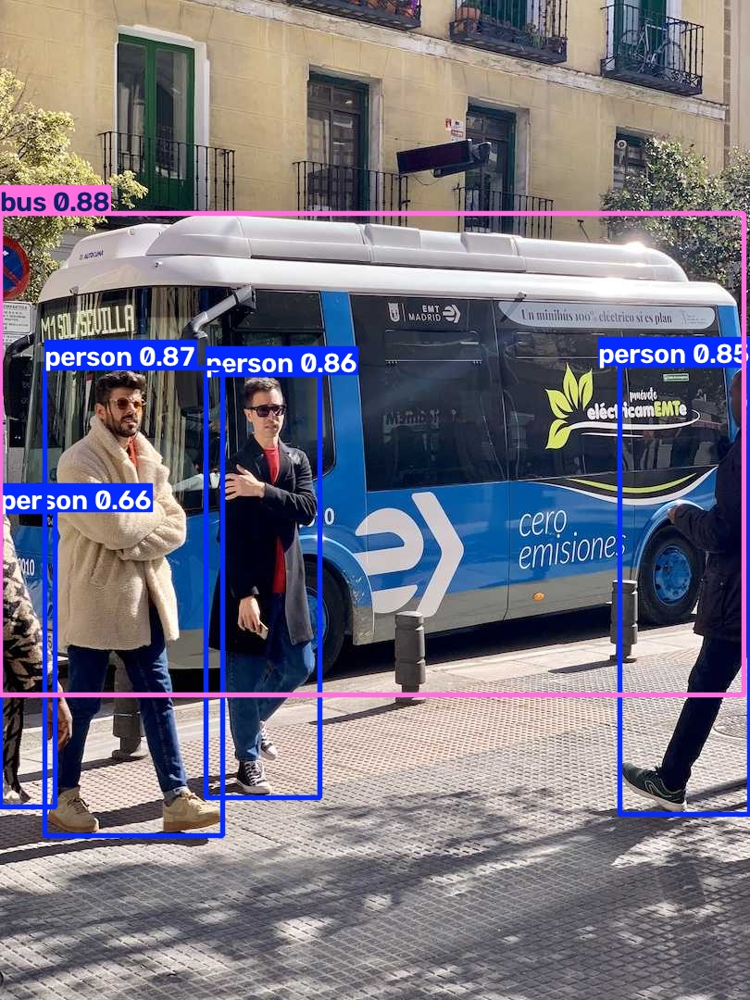

# Projek YOLO: Deteksi Objek untuk Pemula

Repository ini berisi proyek AI Engineering pertama saya saat kelas 10: mendeteksi objek menggunakan model **YOLO26n** dari [Ultralytics](https://github.com/ultralytics/ultralytics). Program dapat membaca webcam, gambar, video, folder gambar, atau URL stream, lalu menampilkan kotak deteksi, nama objek, dan nilai confidence.



## Fitur

- Mendukung webcam, gambar, video, folder gambar, dan URL stream.
- Deteksi GPU otomatis (`cuda:0`) atau CPU.
- Overlay FPS dan jumlah objek per kelas.
- Filter kelas tertentu, misalnya hanya mendeteksi `person` dan `bus`.
- Simpan hasil anotasi ke gambar atau video.
- Ringkasan objek yang terdeteksi setelah program selesai.
- Keluar dengan aman memakai `q`, `ESC`, atau `Ctrl+C`.

## Struktur Proyek

```text
.
├── main.py             # Program utama dan pengatur argumen CLI
├── detector.py         # Pemuat model, deteksi, dan overlay
├── webcam.py           # Jalan pintas untuk demo webcam
├── requirements.txt    # Dependensi Python
├── assets/
│   └── demo-bus.jpg    # Contoh hasil deteksi
├── bus.jpg             # Gambar contoh
├── yolo26n.pt          # Bobot model (diunduh otomatis jika belum ada)
└── runs/
    └── detect/         # Tempat hasil deteksi disimpan
```

## Cara Kerja

1. `main.py` membaca argumen, menentukan sumber gambar, dan memilih GPU atau CPU.
2. `detector.py` memuat model `yolo26n.pt` dengan Ultralytics.
3. Setiap frame diproses oleh YOLO. Model menghasilkan daftar bounding box, kelas objek, dan confidence.
4. Objek dengan confidence di bawah `--conf` dibuang. Ultralytics juga melakukan Non-Maximum Suppression (NMS) agar satu objek tidak diberi banyak kotak.
5. Hasil digambar ke frame. Untuk video dan webcam, program menambahkan overlay FPS dan jumlah objek.
6. Jika `--save` dipakai, frame hasil anotasi disimpan sebagai gambar atau video.
7. Saat program berhenti, jumlah deteksi per kelas ditampilkan sebagai ringkasan.

> Catatan: angka pada ringkasan adalah **jumlah deteksi dari semua frame**, bukan jumlah objek unik. Satu orang yang terlihat di 30 frame akan dihitung 30 kali.

## Instalasi

Prasyarat: Python 3.10 atau lebih baru (proyek ini diuji pada Python 3.14), webcam, dan koneksi internet saat pertama kali mengunduh model.

```bash
git clone https://github.com/damarultrapromax/This-project-was-made-by-10th-grade-students-.git
cd This-project-was-made-by-10th-grade-students-
python -m venv .venv
source .venv/bin/activate
pip install -r requirements.txt
```

Windows:

```powershell
python -m venv .venv
.venv\Scripts\activate
pip install -r requirements.txt
```

### Memakai GPU NVIDIA

`requirements.txt` tidak mengunci versi PyTorch. Agar deteksi memakai GPU, pasang PyTorch versi CUDA sesuai instruksi di [pytorch.org](https://pytorch.org/get-started/locally/), lalu cek:

```bash
python -c "import torch; print(torch.cuda.is_available())"
```

Jika hasilnya `True`, program otomatis memakai `cuda:0`. Jika `False`, deteksi tetap berjalan di CPU.

Model `yolo26n.pt` akan diunduh otomatis oleh Ultralytics jika belum ada di folder proyek.

## Cara Pakai

```bash
# Webcam default (kamera 0)
python main.py

# Webcam lain
python main.py --source 1

# Satu gambar
python main.py --source bus.jpg

# Simpan hasil gambar
python main.py --source bus.jpg --save

# Video dan simpan hasilnya
python main.py --source video.mp4 --save

# Semua gambar dalam folder
python main.py --source ./gambar --save

# Lihat daftar ID kelas model
python main.py --list-classes

# Hanya deteksi orang (0) dan bus (5)
python main.py --source bus.jpg --classes 0 5

# Pakai CPU dan confidence lebih tinggi
python main.py --source video.mp4 --device cpu --conf 0.5

# Tanpa jendela preview (cocok untuk server)
python main.py --source video.mp4 --no-show --save -o hasil.mp4
```

Saat jendela preview terbuka:

- Tekan `q` atau `ESC` untuk berhenti.
- Untuk gambar, tekan tombol apa saja untuk menutup jendela.
- `Ctrl+C` di terminal juga menghentikan program dengan aman.

## Opsi CLI

| Opsi | Default | Keterangan |
| --- | --- | --- |
| `-s`, `--source` | `0` | Indeks webcam, file gambar/video, folder, atau URL stream. |
| `-m`, `--model` | `yolo26n.pt` | Path model. Bisa diganti, misalnya `yolo26s.pt`. |
| `-c`, `--conf` | `0.35` | Ambang confidence (0 sampai 1). |
| `--imgsz` | `640` | Ukuran gambar untuk inferensi. |
| `--device` | `auto` | `auto`, `cpu`, atau `cuda:0`. |
| `--classes` | semua | Filter ID kelas, contoh `--classes 0 2 5`. |
| `--save` | mati | Simpan hasil anotasi. |
| `-o`, `--output` | otomatis | Path file atau folder output. Otomatis mengaktifkan `--save`. |
| `--no-show` | mati | Jalankan tanpa jendela preview. |
| `--verbose` | mati | Tampilkan detail objek setiap frame. |
| `--list-classes` | | Tampilkan daftar kelas model lalu keluar. |

## Hasil Output

Jika `--save` dipakai tanpa `--output`, hasil disimpan di:

```text
runs/detect/predict-<tanggal>-<jam>/
```

Contoh nama file:

- Gambar: `bus.jpg`
- Video: `video-20261102-183000.mp4`
- Webcam: `webcam-20261102-183000.mp4`
- Folder gambar: semua gambar hasil anotasi disimpan dengan nama yang sama.

## Troubleshooting

### Kamera tidak terbuka

- Coba indeks lain: `--source 1` atau `--source 2`.
- Pastikan kamera tidak sedang dipakai aplikasi lain.
- Di Linux, cek perangkat kamera:

```bash
sudo pacman -S v4l-utils
v4l2-ctl --list-devices
ls /dev/video*
```

- Jika muncul error izin, tambahkan pengguna ke grup `video`, lalu login ulang:

```bash
sudo usermod -aG video $USER
```

### Jendela preview tidak muncul

- Di server atau lingkungan tanpa layar, gunakan `--no-show --save`.
- Di Wayland, pastikan XWayland aktif dan variabel `DISPLAY` tersedia.
- Jika OpenCV tidak punya dukungan GUI, pasang `opencv-python` (bukan `opencv-python-headless`).

### CUDA tidak terdeteksi

- Pastikan driver NVIDIA terpasang: `nvidia-smi`.
- Pasang PyTorch versi CUDA yang cocok dari pytorch.org.
- Paksa CPU jika perlu: `--device cpu`.

### Kehabisan memori GPU

- Turunkan ukuran inferensi: `--imgsz 416`.
- Gunakan CPU: `--device cpu`.
- Tutup aplikasi lain yang memakai GPU.

### Model gagal diunduh

Unduh `yolo26n.pt` secara manual dari rilis Ultralytics, lalu letakkan di folder proyek. Program akan memakai file tersebut.

## Tips Belajar

- Bandingkan `--conf 0.25` dan `--conf 0.7` untuk melihat pengaruh ambang confidence.
- Coba `--classes 0` agar program hanya mendeteksi manusia.
- Bandingkan `--imgsz 320` dan `--imgsz 640`: gambar lebih kecil biasanya lebih cepat, tetapi objek kecil lebih sulit dideteksi.
- Coba model yang lebih besar, misalnya `--model yolo26s.pt`, lalu bandingkan kecepatan dan akurasinya.
- Gunakan `--verbose` untuk melihat nama objek dan confidence pada setiap frame.
- Langkah berikutnya: latih model dengan dataset sendiri memakai [dokumentasi Ultralytics](https://docs.ultralytics.com/).

## Lisensi dan Kredit

- Kode proyek ini dibuat untuk pembelajaran.
- Model dan library [Ultralytics YOLO](https://github.com/ultralytics/ultralytics) berlisensi AGPL-3.0. Pelajari lisensinya sebelum memakai proyek untuk keperluan komersial.
- Gambar contoh `bus.jpg` berasal dari contoh Ultralytics.
